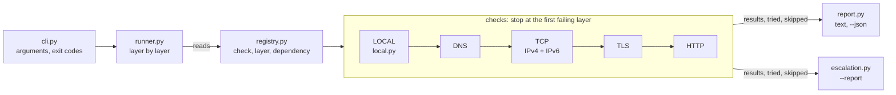

# layerwise

[](https://github.com/eduardo-cozzolino/layerwise/actions/workflows/ci.yml)

**Layer-by-layer network troubleshooting with ticket-ready escalation reports.** `layerwise` tests a network service layer by layer
(local configuration, DNS, TCP over IPv4 and IPv6, TLS, HTTP) and, when something fails, explains in plain language
what that failure tells you about the network and what to check next.

```text
$ layerwise example.com expired.badssl.com
example.com:443
  [ OK ] LOCAL    192.0.2.50 via Wi-Fi, gateway 192.0.2.1, DNS 192.0.2.1 (1190 ms)
  [ OK ] DNS      resolved to 2001:db8::10, 2001:db8::11, 203.0.113.10, 203.0.113.11 (29 ms)
  [ OK ] TCP IPv6 connected to [2001:db8::10]:443 (12 ms)
  [ OK ] TCP IPv4 connected to 203.0.113.10:443 (18 ms)
  [ OK ] TLS      TLSv1.3, certificate valid for 71 more days, issued by SSL Corporation (59 ms)
  [ OK ] HTTP     200 OK (52 ms)

expired.badssl.com:443
  [ OK ] LOCAL    192.0.2.50 via Wi-Fi, gateway 192.0.2.1, DNS 192.0.2.1 (3 ms)
  [ OK ] DNS      resolved to 198.51.100.20 (46 ms)
  [ OK ] TCP IPv4 connected to 198.51.100.20:443 (142 ms)
  [FAIL] TLS      certificate rejected: certificate has expired (256 ms)
         hint: The certificate is expired, self-signed, issued for a different name or
               missing its intermediate chain. Inspect it with: openssl s_client -connect
               198.51.100.20:443 -servername expired.badssl.com
```

```text
$ layerwise localhost:9
localhost:9
  [ OK ] LOCAL    192.0.2.50 via Wi-Fi, gateway 192.0.2.1, DNS 192.0.2.1 (1185 ms)
  [ OK ] DNS      resolved to ::1, 127.0.0.1 (1 ms)
  [FAIL] TCP IPv6 connection refused by [::1]:9 (2047 ms)
         hint: The host answered with a TCP reset: it is reachable, but nothing is
               listening on port 9, or a firewall is actively rejecting. Check that the
               service is running and bound to the right interface.
  [FAIL] TCP IPv4 connection refused by 127.0.0.1:9 (2044 ms)
         hint: ...
```

(The ~2 s on a refused connection is Windows: its TCP stack retries the SYN after a reset.
On Linux the same failure comes back in under a millisecond.)

## Why

"The site is down" is not a diagnosis. The failure could be on the user's machine, in name
resolution, in the network path, in the TLS certificate or in the application itself. Support
engineers ask the same questions in the same order every time, and when the answers aren't written
down, tickets bounce between teams. `layerwise` asks those questions for you, one layer at a time,
explains what each failure means and, with `--report`, turns the diagnosis into evidence the
receiving team can act on.

## What each failure tells you

| Layer | Symptom | What it means |
|---|---|---|
| LOCAL | address 169.254.x.x (APIPA) | No DHCP server answered: cable, Wi-Fi association, DHCP server or switch port (VLAN). |
| LOCAL | no route to an IP target | The routing table has no route to that network: no gateway, or a VPN that is not connected. |
| LOCAL | no default route (name target) | Reported as a warning: normal on corporate networks behind a proxy; DNS still runs. |
| DNS | name does not resolve | The name does not exist, or the DNS server is not answering. Compare with a public resolver. |
| DNS | slow resolution (> 500 ms) | The resolver is slow or far away: every new connection pays this delay. |
| TCP | **connection refused** | The host is reachable and answered with a TCP RST: nothing listens on that port, or a firewall actively rejects. |
| TCP | **timeout** | No answer at all: packets are silently dropped (firewall, ACL, security group) or the host is down. |
| TCP | no route | Your machine has no route to that network. On IPv6 this usually means no IPv6 connectivity. |
| TCP | IPv6 fails, IPv4 works | Reported as a warning: the service is up, but clients that prefer IPv6 may wait before falling back. |
| TLS | certificate rejected | Expired, self-signed, wrong name or missing intermediate chain. |
| TLS | expires in < 14 days | Works today, will break for every client soon. |
| HTTP | 5xx | The network is fine: the problem is the application or its backend. |
| HTTP | 4xx | The server answered but refused the request: URL, authentication or access rules. |

Checks stop at the first layer that fails: if TCP never connects, testing TLS would only add noise.

## Install

Requires Python 3.10+. No third-party dependencies: only the standard library.

```bash
pip install git+https://github.com/eduardo-cozzolino/layerwise.git@v0.1.1
```

Or from a clone, to work on the code: `git clone` the repository, then `pip install -e ".[dev]"`.

## Usage

```bash
layerwise example.com                         # DNS, TCP, TLS and HTTPS on port 443
layerwise example.com:22 198.51.100.7:3389    # several targets; other ports stop at TCP
layerwise https://example.com:8443/login      # URLs work too: scheme, port and path are taken from them
layerwise "[2001:db8::1]:53"                  # IPv6 literal with a port
layerwise intranet.example.com --tls -p 8443  # force the TLS check on a non-standard port
layerwise example.com --json                  # machine-readable output
layerwise 203.0.113.10:3389 --report          # plain-text report to paste into a ticket
```

| Exit code | Meaning |
|---|---|
| 0 | every check passed |
| 1 | at least one warning |
| 2 | at least one failure |

The exit codes make `layerwise` easy to use from scripts and monitoring jobs.

### Ticket report

`--report` prints plain ASCII text meant for a ticket: a verdict with the team that can fix it
on the first line, then the local context, the addresses tried and the evidence for every check.
Checks that did not run say which lower layer failed. `--json` carries the same evidence for
each target: `tried` (the addresses tested) and `skipped` (each check not run, with its cause).

```text
$ layerwise 203.0.113.10:3389 -t 2 --report
VERDICT: FAIL at TCP IPv4 -> suggested team: firewall

Date:    2026-10-18 09:57:40 UTC
Tool:    layerwise 0.1.1
Local:   192.0.2.50 via Wi-Fi, gateway 192.0.2.1, DNS 192.0.2.1, 2001:db8::53
Target:  203.0.113.10:3389
Tried:   203.0.113.10

Checks:
  [ OK ] LOCAL     1175 ms  192.0.2.50 via Wi-Fi, gateway 192.0.2.1, DNS 192.0.2.1, 2001:db8::53
                local_addresses: 192.0.2.50
                interface: Wi-Fi
                gateways: 192.0.2.1
                dns_servers: 192.0.2.1, 2001:db8::53
  [SKIP] DNS             -  target is an IP address, nothing to resolve
  [FAIL] TCP IPv4  2007 ms  no answer from 203.0.113.10:3389 within 2 s
                hint: Not even a reset came back: packets are probably dropped silently by a firewall, ACL or security group, or the host is down. Compare with another port on the same host, or run a traceroute.
                os_error: timed out
                reason: timeout
```

The suggested team follows the first failing layer: LOCAL -> desktop support, DNS -> DNS,
TCP timeout or no route -> firewall, TCP refused -> service owner, TLS -> site/certificate owner,
HTTP -> application. With warnings only, the first warning decides: slow DNS or slow TCP ->
network (latency or path), IPv6 failing while IPv4 works -> network (IPv6).

Gateway, DNS servers and interface name come from structured data, never from translated
command output: PowerShell (as JSON) on Windows; on Linux the kernel's routing tables
(`/proc/net/route`, `/proc/net/ipv6_route`) and `/etc/resolv.conf`. On other systems, such as
macOS, the report says they were not collected and why.

## Design



```text
cli.py         argument parsing, exit codes
targets.py     "host", "host:port", "[v6]:port" or URL  ->  Target
registry.py    the checks in one table: name, layer, dependency
runner.py      runs the registry by layer, skips what depends on a failure
local.py       layer 0: source address, route out, gateway and DNS servers
checks.py      DNS, TCP, TLS, HTTP; each returns a CheckResult and never raises
escalation.py  the --report text (a pure function)
report.py      text and JSON output
text.py        ASCII helpers: accents dropped, international names in punycode
```

Output is English ASCII whatever the Windows language: messages are built from exception types
and error codes, and the operating system's translated text only goes into the details.

Tests run against real sockets and a local HTTP server on `127.0.0.1`, with fakes for routing,
PowerShell and the Linux `/proc` files, so they need no internet access. CI runs them on Linux, Windows and macOS, plus
a smoke test against real hosts.

```bash
pip install -e ".[dev]"
ruff check . && ruff format --check .
mypy --platform linux && mypy --platform darwin && mypy --platform win32
pytest
```

## Roadmap

- [ ] --redact: replace your own addresses with documentation addresses, to share output publicly
- [ ] Path MTU check (ping with the Don't Fragment bit) to catch MTU black holes on VPNs and tunnels
- [ ] Traceroute on timeout, to show where along the path packets stop
- [ ] Query a specific DNS server and compare its answer with the system resolver
- [ ] Run several targets in parallel
- [ ] Show the full certificate chain and the SANs

## Related tools

- [netwhy](https://github.com/mqasimca/netwhy): the same idea (find the first broken layer of
  DNS, TCP, TLS, HTTP), written in Rust for Linux and macOS; layerwise is pure Python and runs
  on Windows too.
- [httpstat](https://github.com/reorx/httpstat): shows the timing of one HTTP request through
  curl; it measures performance, it does not diagnose failures.
- [rkn-block-checker](https://github.com/WhyNotLab/rkn-block-checker): the same layered logic,
  aimed at recognizing blocks by Russian censorship.
- [netchecks](https://github.com/hardbyte/netchecks): verifies that connectivity matches what
  you expect (policy testing); it does not explain why something fails.

## License

MIT

## About

Designed and reviewed by Eduardo Cozzolino as a portfolio project on the path from technical
support to network engineering. Implemented with the help of Claude Code; every module is covered
by tests.
